# AnkiNOS Architecture

AnkiNOS replaces Anki's DeckBrowser and Overview WebViews, skins the Reviewer chrome (without touching `#qa` or Anki's native rating logic), and adds frameless/modal WebView tools (`Ctrl+K` Quick Commands and Contextual Notebook) — all running 100% offline with zero external runtime dependencies.

---

## 1. High-Level System Diagram

```mermaid
flowchart TB
    subgraph AnkiHost["Anki Desktop Host (PyQt6 / main thread)"]
        INIT["__init__.py"]
        INT["integration.py<br/>Hooks, Settings, Qt Menus/Dialogs, pycmd nos:*"]
        REV["reviewer_ui.py<br/>Reviewer chrome, Focus timer, pycmd nos-review:*"]
        TOOLS["study_tools_ui.py<br/>ToolDialog WebView, pycmd nostool:*"]
        I18NPY["i18n.py<br/>Pure-Python Qt/error i18n"]
    end

    subgraph Workers["Background Workers (QueryOp / CollectionOp / taskman)"]
        DATA["data.py<br/>Dashboard & Overview snapshots + cache"]
        GRAPHS["graphs_data.py<br/>col._backend.graphs() + calendar/metrics"]
        STUDY["study_data.py<br/>30/60d timing & insight queries"]
        DAILYB["daily_bridge.py + daily_scheduler.py<br/>FSRS/SM-2 R solver & due shifts"]
        BACKUP["backup_store.py<br/>.nosbackup ZIP + SHA-256 + atomic swap"]
        MEDIA["media_store.py<br/>Image metadata + thumbnail/wall jobs"]
    end

    subgraph Storage["Profile-Local Storage (user_files/&lt;sha256(profile)[:20]&gt;/)"]
        CFG["Anki add-on config.json / meta.json<br/>profiles[name]"]
        FDB["focus.sqlite3 (focus_store.py)"]
        WDB["workspace.sqlite3 (workspace_store.py)"]
        DDB["daily_schedule.sqlite3 (daily_store.py)"]
        IMGS["&lt;uuid&gt;.(png|jpg|webp)<br/>-thumb.png, -wall.jpg"]
    end

    subgraph WebViews["WebView Surfaces (HTML + Vanilla ES2022 JS + CSS)"]
        DASH["DeckBrowser: ankios-ui.html<br/>Home + Daily + Stats + Library + Settings + Studio"]
        OVW["Overview: ankios-overview.html<br/>Deck queue + Today stats + Congrats"]
        RVW["Reviewer: reviewer_ui.py shell<br/>Top chrome + Focus bar (#qa untouched)"]
        TWIN["ToolDialog: ankios-tools.html<br/>Ctrl+K Commands / Notebook"]
    end

    INIT --> INT
    INT --> REV
    INT --> TOOLS
    INT --> I18NPY
    REV --> I18NPY
    TOOLS --> I18NPY

    INT <-->|"pycmd nos:* / eval AnkiNOS.receive"| DASH
    INT <-->|"pycmd nos:* / eval AnkiNOS.receive"| OVW
    REV <-->|"pycmd nos-review:* / eval NOSReview"| RVW
    TOOLS <-->|"pycmd nostool:* / eval NOSTool.receive"| TWIN

    INT --> DATA & GRAPHS & STUDY & DAILYB & BACKUP & MEDIA
    REV --> FDB
    TOOLS --> WDB
    DAILYB --> DDB
    MEDIA --> IMGS
    INT --> CFG
```

---

## 2. WebView Surfaces & Script Load Order

Anki injects CSS/JS registered on `content.css` / `content.js` via `webview_will_set_content` (or `AnkiWebView.stdHtml` for `ToolDialog`). **Order matters**: `i18n.js` -> `i18n-en.js` -> `theme.js` MUST load before page scripts, and `theme.css` / `layouts.css` MUST load last so theme tokens and layout overrides win CSS cascade.

| Surface | Context / Entry | HTML Template | Script Load Order | CSS Load Order |
| :--- | :--- | :--- | :--- | :--- |
| **Dashboard** | `DeckBrowser` in `integration.py` | `ankios-ui.html` (body extracted) | `i18n.js`, `i18n-en.js`, `theme.js`, `runtime-guard.js`, `layouts.js`, `dashboard.js`, `stats-page.js`, `focus-dashboard.js`, `media-studio.js`, `study-dashboard.js`, `daily-schedule.js` | `dashboard.css`, `stats-page.css`, `focus-dashboard.css`, `media-studio.css`, `study-dashboard.css`, `daily-schedule.css`, `theme.css`, `layouts.css` |
| **Overview** | `Overview` in `integration.py` | `ankios-overview.html` (body extracted) | `i18n.js`, `i18n-en.js`, `theme.js`, `runtime-guard.js`, `overview.js` | `dashboard.css`, `overview.css`, `theme.css` |
| **Reviewer** | `Reviewer` in `reviewer_ui.py` | Wraps `content.body` in `#nos-review-shell` (puts `data-i18n-skip` on `#nos-review-card`) | `i18n.js`, `i18n-en.js`, `theme.js`, `runtime-guard.js`, `reviewer.js` | `reviewer.css`, `focus-review.css`, `theme.css` |
| **Reviewer Bottom** | `ReviewerBottomBar` in `reviewer_ui.py` | Appends theme + answer key `<textarea hidden>` | `theme.js`, `reviewer-bottom.js` | `reviewer-bottom.css`, `theme.css` |
| **Tools / Notebook** | `ToolDialog` in `study_tools_ui.py` | `ankios-tools.html` (body extracted) | `i18n.js`, `i18n-en.js`, `theme.js`, `tools.js`, `commands.js`, `notebook.js` | `tools.css`, `theme.css` |

> **Important**: `ankios-ui.html`, `ankios-overview.html`, `ankios-review.html`, `ankios-tools.html`, and `assets/reviewer-controls-preview.html` also run standalone in a regular browser (`file://`) for rapid UI development and headless Chromium tests. All `<script>` tags inside `<body>` are stripped by `_body_template()` when running inside Anki.

---

## 3. Anki Hooks & Monkeypatch Guards

### Registered `gui_hooks`
- **`integration.py:install()`**:
  - `profile_did_open` -> `_guard_unused_heatmaps`
  - `webview_will_set_content` -> `replace_content` (DeckBrowser & Overview)
  - `webview_did_receive_js_message` -> `bridge` (`nos:*`)
  - `operation_did_execute` -> `_operation_finished` (increments `_data_revision`, schedules 120ms debounced refresh)
  - `profile_will_close` -> `_profile_closing` (clears all caches, stops timers, restores chrome)
  - `sync_did_finish` -> `_sync_finished` (invalidates all caches, triggers refresh)
  - `state_will_change` -> `_state_changing` (tracks `last_study_deck`, restores chrome on exit)
  - `state_did_change` / `deck_browser_did_render` / `top_toolbar_did_redraw` -> `_sync_chrome`
  - `overview_did_refresh` -> `_overview_refreshed` (intercepts Anki's Svelte "Congratulations!" completion screen cleanly)
- **`reviewer_ui.py:install()`**:
  - `profile_will_close`, `webview_will_set_content`, `webview_did_receive_js_message` (`nos-review:*`), `state_will_change`, `reviewer_did_show_question`, `reviewer_did_show_answer`, `reviewer_did_answer_card`
  - Plus `QTimer` (10s Focus checkpoint) and `_FocusWindowGuard` (`WindowDeactivate` auto-pauses Focus).
- **`study_tools_ui.py:install()`**:
  - Global `Ctrl+K` `QAction` on `mw`, `profile_did_open` (syncs action label language), `profile_will_close` (`reset_tools`).

### Defensive Guards (Reversible when `enabled() == False`)
1. **`_guard_unused_heatmaps()`**: Short-circuits legacy Review Heatmap add-on rendering on `deckbrowser`/`overview` views (leaves Stats window and disabled-NOS state untouched).
2. **`_guard_unused_deck_html()`**: Short-circuits `DeckBrowser._renderDeckTree` HTML string building while preserving Anki's scheduler tree calculation (`context._render_data.tree`).
3. **`_guard_live_updates()`**: Prevents Anki's `DeckBrowser/Overview.op_executed` and `refresh` from reloading the whole WebView HTML when cards/decks change in Add/Browser dialogs (instead pushes live JSON snapshots via `send()`).
4. **`_ChromeGuard` event filter**: Keeps `mw.toolbarWeb` and `mw.bottomWeb` cleanly hidden in Dashboard/Overview (and keeps `mw.bottomWeb` visible in Reviewer), restoring original visibility on exit or fallback.

---

## 4. Concurrency, Caching & Performance Model

### Generation & Staleness Tokens
- `_generation` increments on every WebView replacement, navigation start (`_begin_navigation()`), or profile close. Any background worker finishing with an old `(_generation, mw.pm.name)` drops its result silently.
- `_data_revision` increments on real collection mutations (`card`, `note`, `deck`, `config`, `deck_config`, `notetype`, `study_queues`, `mtime`), Daily Schedule mutations, restores, and syncs.
- `_navigating = True` cancels pending refreshes so an outgoing dashboard scan never blocks entering Overview or Reviewer.

### Multi-Tier Caching
1. **Inline Bootstrap (`quick_snapshot` / `overview_base`)**: Injected as `<textarea id="nos-*-bootstrap" hidden>` directly in the initial HTML so first frame paints live deck counts & Study button immediately (`partial: true` if revlog cache is cold, followed by parallel `QTimer.singleShot(0, refresh(prefetch=True))`).
2. **`data._AGGREGATES`**: Scoped to `(id(col), revision, total_changes(), day_cutoff)`. Incremental mode (`review_only=True`) rescans only today's revlog after answering cards in Reviewer instead of scanning full history.
3. **Lazy Archive Years**: Initial snapshot loads only the current year + 60 days for trend comparisons; older years load on demand via `history_year` using `revlog`'s primary-key range index. Long streaks use a recursive indexed `EXISTS` CTE.
4. **`study_data._cache`**: Keyed by `(id(col), revision, total_changes(), day_cutoff)`.
5. **Frontend DOM Reuse**:
   - **Library**: Does not rebuild DOM while `#library-dialog` is closed; expanding one branch patches only that branch's `.deck-group`.
   - **Stats**: Keeps rendered SVG DOM across tab switches for the same filter key; renders 13 native sections in 4-card `requestAnimationFrame` batches.
   - **Media Studio**: Decodes 480px PNG thumbnails in gallery/inspector (never 24MP originals); pages use 2048px JPEG `-wall.jpg` copies built off-thread.

---

## 5. Security & Recovery Boundaries

- **XSS Prevention**: All deck names, card previews, note titles/bodies, and resource paths are HTML-escaped or assigned via `textContent`. Notebook's inline Markdown preview (`assets/notebook.js`) builds DOM nodes via `createTextNode` + `createElement`, never injecting user HTML.
- **URL Allowlisting**: Web exports are restricted by regex in `mw.addonManager.setWebExports(...)`; JS validates all wallpaper/thumbnail URLs against strict regexes (`/_addons/.../user_files/[0-9a-f]{20}/[0-9a-f]{32}...`).
- **Archive Safety (`backup_store.py`)**: Rejects symlinks, encrypted ZIP entries, path traversal, oversized files, schema mismatches, and SHA-256 mismatches; stages to a temp dir, writes a pre-restore safety backup to `user_files/backups/`, and atomically swaps with rollback on failure.
- **Runtime Guard (`assets/runtime-guard.js`)**: Catches fatal script errors or 8-second boot timeout and invokes `runtime_failure` / `nos-review:native`, cleanly falling back to Anki's native UI via `_fallback()`.
